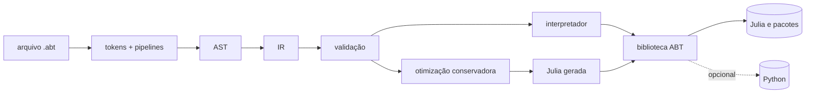

<div align="center">

# ABT

**Uma linguagem de alto nível, em português, para dados, estatística e bioinformática.**<br>
Escreva a intenção. O Julia executa.

<br>


[**Manual**](https://gustavodmentz.github.io/ABT-Language/) ·
[Começar](#-começando-em-2-minutos) ·
[Exemplos](#-um-gostinho-de-abt) ·
[Operações](#-o-que-já-vem-pronto) ·
[Aplicações](applications/README.md) ·
[Contribuir](docs/src/contributing/index.md)

</div>

<br>

```abt
dados = [1, 2, 3, 4, 5]
dados
    filtrar onde valor > 2
    transformar com valor * 10
    limitar a 2
    mostrar
```

```text
[30, 40]
```

---

## ✨ Por que ABT

| Característica | Como é na prática |
|---|---|
| 🗣️ **Fala português** | Palavras-chave como `mostrar`, `se`, `para cada`, `função`, `filtrar … onde`; aliases em inglês quando existem. |
| 🔗 **Pipelines legíveis** | Encadeie `filtrar`, `transformar` e `limitar` por indentação, terminando em `mostrar`. |
| 🧪 **Ciência incluída** | CSV tipado, estatística, bioestatística, FASTA/FASTQ, alinhamento, álgebra linear e gráficos, sem importar nada. |
| 🛡️ **Rigor explícito** | Esquemas e políticas de valores ausentes são declarados; nada é convertido em silêncio. |
| ⚙️ **Julia por baixo** | Interpretador e gerador de código Julia com resultados equivalentes. A interoperabilidade com Julia e Python é opcional e explícita. |

> [!NOTE]
> ABT é **experimental**. O runtime homologado é o Julia 1.13.3, e a ponte com Python (PythonCall) é opcional.

---

## 🚀 Começando em 2 minutos

**Requisitos:** Julia 1.13.3 e Python 3 (só para os scripts de instalação).

```bash
# 1. Aponte para o seu Julia 1.13.3
export ABT_JULIA=/caminho/para/julia-1.13.3/bin/julia

# 2. Instale (por usuário, sem sudo)
python3 tools/install.py

# 3. Confira o ambiente
~/.local/bin/abt doctor
```

```bash
# 4. Seu primeiro programa
printf 'mostrar "Olá, mundo!"\n' > ola.abt
~/.local/bin/abt run ola.abt
```

> Sem instalar? Use `bin/abt` direto da raiz do clone. Para atualizar, rode `python3 tools/install.py` de novo; para remover, `python3 tools/uninstall.py`.

### Comandos da CLI

| Comando | O que faz |
|---|---|
| `abt run arquivo.abt` | Executa o programa |
| `abt check arquivo.abt` | Valida sem executar |
| `abt operacoes` | Lista as extensões modulares |
| `abt doctor` | Verifica instalação e ambiente |
| `abt --help` · `abt --version` | Ajuda e versão |

Códigos de saída: `0` sucesso · `1` erro no programa · `2` uso ou ambiente.
A CLI usa `--compile=min` por padrão; `ABT_JULIA_COMPILE=all` ativa a compilação Julia completa.

---

## 👀 Um gostinho de ABT

<table>
<tr>
<td width="50%" valign="top">

**Estatística em uma linha**

```abt
amostra = [12, 15, 18, 21, 24, 30]
mostrar descrever(amostra)
```

```text
(quantidade = 6, soma = 120, media = 20.0,
 mediana = 19.5, desvio_padrao = 6.48074069840786,
 minimo = 12, maximo = 30)
```

<sub>(a saída real fica em uma única linha; quebrei por legibilidade)</sub>

</td>
<td width="50%" valign="top">

**Funções e recursão**

```abt
função fatorial(n) {
    se n <= 1 {
        retornar 1
    }
    retornar n * fatorial(n - 1)
}
mostrar fatorial(5)
```

```text
120
```

</td>
</tr>
</table>

**CSV tipado, com tudo explícito** (`applications/data/resumo_csv.abt`)

```abt
colunas = esquema("nome", "texto", "grupo", "texto", "valor", "real")
dados = ler_csv("applications/data/sample.csv", colunas, "erro")
grupo_a = filtrar_tabela(dados, "grupo", "==", "A")
selecionados = filtrar_tabela(grupo_a, "valor", ">=", 10.0)
resumo = resumir_coluna(selecionados, "valor")
mostrar registro("selecionados", resumo.quantidade, "soma", resumo.soma, "media", resumo.media)
```

```text
(selecionados = 2, soma = 32.0, media = 16.0)
```

O esquema declara os tipos e a política `"erro"` diz o que fazer com campos ausentes. O programa completo está em [`applications/`](applications/README.md).

---

## 📦 O que já vem pronto

**84 operações públicas**, organizadas por domínio. Cada uma tem contrato, erros e exemplo executável na [referência](docs/src/standard-library/index.md).

| Domínio | Para quê | Alguns exemplos |
|---|---|---|
| 🧰 [**Núcleo, listas e texto**](docs/src/standard-library/core.md) | Registros, listas (contar, extremos, ordenar), conversões, texto, ambiente | `registro` · `descrever` · `contar` · `ordenar` · `sem_duplicatas` · `para_real` |
| 📄 [**CSV e tabelas**](docs/src/standard-library/tables.md) | Ler, filtrar e transformar tabelas tipadas | `ler_csv` · `filtrar_tabela` · `resumir_coluna` |
| 📊 [**Estatística**](docs/src/standard-library/statistics.md) | Testes, intervalos, regressão, distribuições | `teste_t` · `correlacao` · `regressao_linear` |
| 🗂️ [**Dados e JSON**](docs/src/standard-library/data.md) | Agrupar, contar categorias, serializar | `agrupar_dados` · `contar_categorias` · `codificar_json` |
| 🧬 [**Bioinformática e gráficos**](docs/src/standard-library/science.md) | FASTA, alinhamento, figuras | `ler_fasta` · `alinhar_sequencias` · `salvar_figura` |
| 🔬 [**Bibliotecas científicas 0.13**](docs/src/standard-library/scientific0130.md) | FASTQ, k-mers, matrizes, valores-p, otimização | `ler_fastq` · `produto_matricial` · `ajustar_valores_p` |
| 🧪 [**Bioinformática avançada 0.14**](docs/src/standard-library/bio0140.md) | GC, tradução por quadro, motivos, alinhamento com BLOSUM62/PAM250, métricas e filtros de FASTQ | `conteudo_gc` · `alinhar_par` · `filtrar_fastq` |

---

## 🧭 Como funciona



O mesmo front-end alimenta dois caminhos de execução com resultados equivalentes, verificados por testes diferenciais. Detalhes em [arquitetura](docs/src/internals/architecture.md) e [compilador e IR](docs/src/internals/compiler.md).

---

## 📚 Documentação

| Quero… | Vá para |
|---|---|
| Aprender do zero | [Primeiro programa](docs/src/tutorials/first-program.md) |
| Entender a linguagem | [Sintaxe](docs/src/manual/syntax.md) · [Coleções e pipelines](docs/src/manual/collections.md) · [Gramática](docs/src/reference/grammar.md) |
| Consultar operações | [Referência da biblioteca](docs/src/standard-library/index.md) |
| Ver programas completos | [Exemplos](docs/src/examples/programs.md) · [`applications/`](applications/README.md) |
| Usar ciência de dados | [Estatística](docs/src/tutorials/statistics.md) · [Bioestatística](docs/src/tutorials/biostatistics.md) · [Bioinformática](docs/src/tutorials/bioinformatics.md) · [Bioinformática avançada](docs/src/tutorials/bioinformatics-advanced.md) |
| Conhecer os limites | [Semântica e limites](docs/src/reference/semantics.md) · [Ciência 0.13](docs/src/scientific/overview.md) |
| Ir fundo | [Bioestatística 0.12](docs/BIOESTATISTICA_0120.md) · [Auditoria independente](docs/AUDITORIA_FINAL_BIOESTATISTICA_0120.md) · [Extensões](docs/ARQUITETURA_EXTENSOES_0118.md) · [Arquivos e tabelas](docs/ARQUIVOS_TABELAS_0118.md) · [Benchmarks](docs/BENCHMARK_ESCALABILIDADE.md) |

O site publicado está em **<https://gustavodmentz.github.io/ABT-Language/>**.

---

## 🛠️ Desenvolvimento

```bash
python3 tests/run_all_tests.py --julia "$ABT_JULIA" --timeout 180   # suíte de testes
python3 tools/validate_docs.py                                      # documentação e exemplos
julia --project=docs docs/make.jl                                   # build do site
```

<details>
<summary><b>Mais detalhes para quem contribui</b></summary>

<br>

- Testes diferenciais e de aplicações ficam em [`tests/`](tests/); evidências históricas, em [`logs/`](logs/).
- Para adicionar uma operação, mantenha a equivalência entre o interpretador e a Julia gerada. O passo a passo está no [guia de contribuição](docs/src/contributing/index.md).
- A extensão de VS Code em [`vscode/abt-language`](vscode/abt-language) oferece realce lexical; não há LSP.
- Mapa de identidade e CLI: [`docs/MAPA_IDENTIDADE.md`](docs/MAPA_IDENTIDADE.md).

</details>

---

<div align="center">

<sub>ABT 0.14.0 · feita para ser lida como o que ela faz</sub>

</div>
