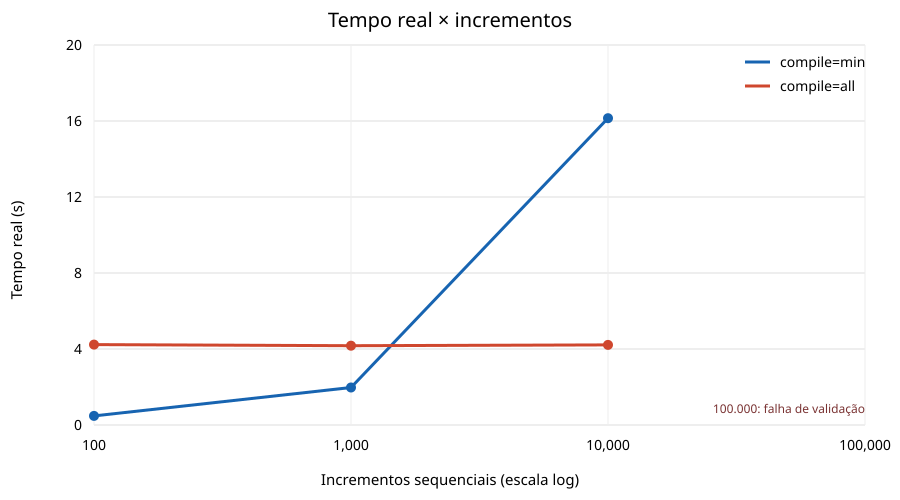
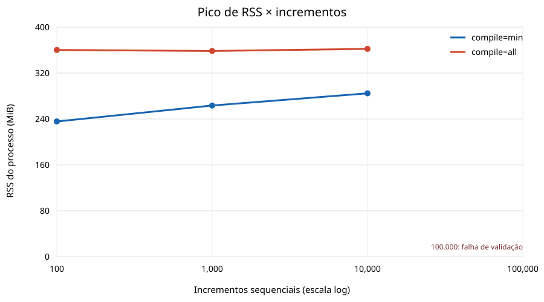

# Benchmark de escalabilidade — ABT 0.11.8

## Escopo e metodologia

Medição local em 7/11/2026, sem alterações no interpretador ou na semântica do ABT. Cada programa contém `x = 0`, **N linhas literais** `x = x + 1` e `mostrar x`. Portanto, o tamanho do arquivo, o parse, a validação e a execução crescem juntos; este ensaio não isola o custo de uma operação aritmética. Todos os processos são novos e independentes. O script verifica código de saída zero e saída padrão exatamente igual a `N` seguido de quebra de linha.

Cada execução usa `/usr/bin/time -v`. O tempo real tabulado é a medição de alta resolução de `time.perf_counter()` em torno do processo; o tempo real arredondado do `time -v`, CPU de usuário/sistema e RSS máximo permanecem nos logs brutos. RSS é o **pico do processo inteiro**, não memória exclusiva do ABT nem alocações internas de Julia. As estatísticas abaixo usam as dez execuções válidas por combinação. O script interrompe repetições de uma combinação após erro ou timeout, para não apresentar falhas como amostras de desempenho bem-sucedidas.

Ambiente: Ubuntu Linux x86-64, kernel 7.0.0-42-generic, Intel Core i5-7400 (4 núcleos), 7,6 GiB de RAM física e 4 GiB de swap, Julia 1.13.3, `JULIA_NUM_THREADS=1`, `LC_ALL=C`. Havia outros processos no host; não houve isolamento de CPU. O depot Julia usado foi `/tmp/abt-perf-final-depot` seguido de `abt_v116/.julia_depot`; seu cache pré-compilado já existia. Os números descrevem este ambiente e essa versão, não uma promessa de desempenho em outra máquina.

## Resultados válidos

Em cada célula: **mediana (mínimo–máximo)**. CPU separa tempo de usuário e de sistema; RAM é o RSS máximo em MiB. `min` e `all` selecionam `ABT_JULIA_COMPILE`, mantendo o mesmo interpretador ABT.

| Incrementos | Compilação | Execuções corretas | Tempo real (s) | CPU usuário (s) | CPU sistema (s) | Pico RSS (MiB) |
|---:|:---:|---:|---:|---:|---:|---:|
| 100 | min | 10/10 | 0,478 (0,469–0,488) | 0,470 (0,460–0,470) | 0,090 (0,080–0,100) | 235,645 (235,438–235,750) |
| 100 | all | 10/10 | 4,231 (4,199–4,306) | 4,125 (4,090–4,170) | 0,160 (0,140–0,170) | 360,307 (357,676–362,645) |
| 1.000 | min | 10/10 | 1,972 (1,906–2,081) | 1,930 (1,880–1,970) | 0,120 (0,100–0,130) | 263,523 (263,328–263,742) |
| 1.000 | all | 10/10 | 4,176 (4,068–4,571) | 4,070 (3,950–4,460) | 0,165 (0,140–0,190) | 358,506 (355,191–361,730) |
| 10.000 | min | 10/10 | 16,145 (15,780–16,806) | 15,980 (15,630–16,390) | 0,135 (0,110–0,160) | 284,688 (283,875–285,809) |
| 10.000 | all | 10/10 | 4,216 (4,043–4,482) | 4,105 (3,970–4,340) | 0,160 (0,140–0,190) | 362,217 (359,914–387,465) |





O eixo horizontal é logarítmico. Os gráficos omitem 100.000 como ponto de desempenho válido porque não houve execução correta nesse tamanho.

## Custo por incremento e ponto de vantagem

| Incrementos | `min`: tempo total / N (ms) | `all`: tempo total / N (ms) | Modo mais rápido |
|---:|---:|---:|:---|
| 100 | 4,7828 | 42,3147 | min |
| 1.000 | 1,9722 | 4,1761 | min |
| 10.000 | 1,6145 | 0,4216 | all |

Essa divisão inclui inicialização, parse, validação e compilação; **não é** tempo marginal de uma única soma. Entre 1.000 e 10.000 linhas, a diferença de medianas corresponde a aproximadamente 1,575 ms por incremento adicional em `min`, enquanto `all` permaneceu perto de 4,2 s totais. `all` supera `min` em 10.000 linhas e perde em 1.000; o cruzamento está **entre esses dois pontos medidos**. Não foi medido um limiar exato. Em 10.000, `all` foi aproximadamente 3,83 vezes mais rápido, com pico mediano de RSS cerca de 77,5 MiB maior.

## Limite em 100.000 linhas

Ambos os modos falharam antes de produzir `100000`. O diagnóstico foi `Erro semântico: malformed IR: structural validation budget exceeded` (código de saída 1). A primeira tentativa de `all` durou 4,862 s e atingiu 499,4 MiB RSS; a primeira de `min` durou 119,891 s e atingiu 444,2 MiB RSS. Esses são **custos de tentativas falhas**, não medições de execução de 100.000 incrementos. As nove repetições restantes por modo foram interrompidas: a entrada ultrapassa o orçamento estrutural do validador e repetir a mesma falha não verificaria o resultado correto. Assim, o critério de dez repetições não foi atingido nesse cenário. O limite é do programa/validação sob a configuração atual; não foi alterado para esta auditoria.

## Reprodução no Ubuntu

Na raiz deste projeto, com Julia 1.13.3 instalada e `/usr/bin/time` disponível:

```bash
export ABT_JULIA=/caminho/para/julia-1.13.3/bin/julia
export JULIA_DEPOT_PATH=/caminho/para/depot-com-ABT-precompilado
python3 bench_scalability.py --repetitions 10 --timeout-100k 120
python3 plot_scalability.py
```

Para reproduzir exatamente o ambiente desta medição, o depot foi definido como `/tmp/abt-perf-final-depot:/home/gumentz/.codex/.chatgpt-projects/g-p-6aed28c64c608191837b0b5384a649bb/abt_v116/.julia_depot` e `ABT_JULIA` como `/home/gumentz/.julia/juliaup/julia-1.13.3+0.x64.linux.gnu/bin/julia`. O script gera entradas determinísticas em `benchmarks/scalability/incrementos_*.abt` e grava cada tentativa imediatamente em `benchmarks/scalability/results.json`, mais stdout e saída integral de `/usr/bin/time -v` em `benchmarks/scalability/raw/`. Ele pula tentativas já registradas; para uma rodada inteiramente nova, use uma cópia limpa do diretório de resultados. Cada arquivo de entrada pode ser executado diretamente, por exemplo:

```bash
ABT_JULIA_COMPILE=all /usr/bin/time -v bin/abt run benchmarks/scalability/incrementos_10000.abt
```

Os gráficos SVG são gerados apenas com a biblioteca padrão de Python. Os dados brutos contêm 62 tentativas: 60 corretas e duas falhas em 100.000. Nenhuma implementação do ABT foi modificada. A conclusão de escalabilidade é restrita à faixa validada: a opção `all` paga mais inicialização e mais RSS, mas vence claramente em 10.000 atribuições sequenciais; 100.000 ultrapassa o orçamento atual de validação e permanece sem resultado executável neste ensaio.
