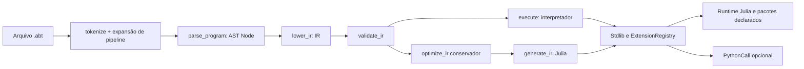

# Arquitetura real

O arquivo `src/ABT.jl` contém lexer, parser, AST, IR, validador, interpretador, otimizador e gerador. `src/CLI.jl` é a interface pública chamada por `bin/abt`. `src/Runtime/Bridge.jl` medeia módulos externos. `src/Stdlib*.jl` implementa operações compartilhadas e `src/ExtensionRegistry.jl` registra as modulares. `Project.toml`/`Manifest.toml` definem o ambiente Julia; `ABT.packages.toml` restringe a superfície de chamadas Julia explícitas em programas ABT.

`src/StdlibRender.jl` apresenta registros, listas, tabelas e FASTA. `mostrar` não altera os dados. O gerador incorpora apenas implementações das operações usadas, evitando carregar pacotes opcionais na inicialização. A ponte PythonCall é carregada apenas quando há import Python.

O repositório separa `applications/`, `examples/`, `tests/`, `benchmarks/`, `docs/`, `logs/`, `tools/`, `bin/` e `vscode/`. `pseudo.jl` e `bridge_runtime.jl` preservam compatibilidade com ferramentas históricas. Os relatórios técnicos antigos permanecem na raiz de `docs/` como evidência, enquanto o site usa `docs/src/`.
