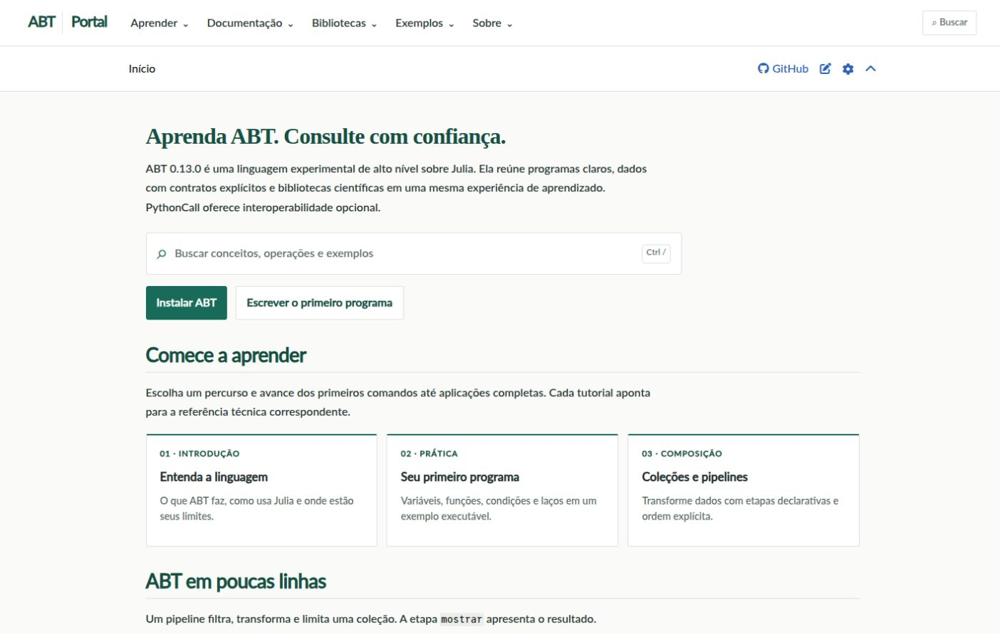
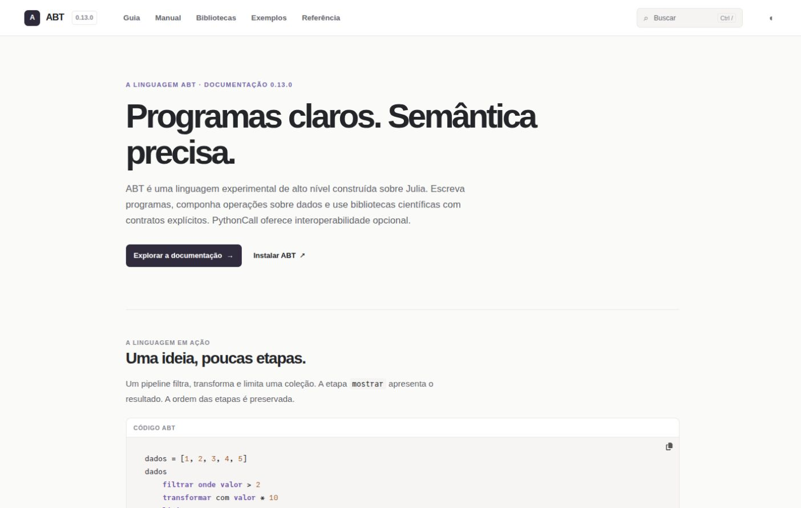
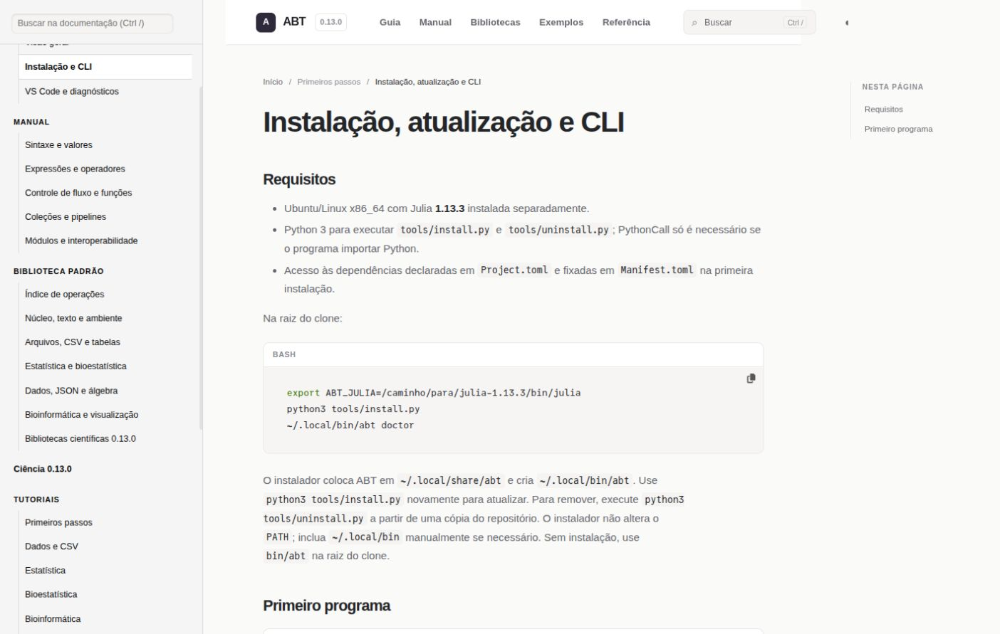
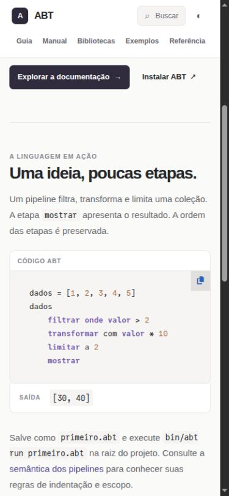

# Revisão visual do portal ABT

## Direção

O portal usa uma hierarquia editorial clara, tipografia sóbria, acentos discretos e espaços consistentes. A navegação principal aponta diretamente para Guia, Manual, Bibliotecas, Exemplos e Referência. A estrutura de leitura do Documenter, a busca, os temas claro e escuro e os exemplos executáveis foram preservados.

## Evidências

| Antes | Depois |
| --- | --- |
|  |  |

As capturas são de páginas renderizadas localmente, em viewport de 1440 × 900 ou 390 × 844. O arquivo de imagem registra a área útil do navegador, ligeiramente menor que o viewport configurado.

## Conferência manual

| Página | 1440 | 1280 | 768 | 390 |
| --- | --- | --- | --- | --- |
| Início | Conferida | Conferida | Conferida | Conferida |
| Instalação e CLI | Conferida | Conferida | Conferida | — |
| Sintaxe e valores | Conferida, tema escuro | — | — | — |
| Índice de operações | Conferida, tema escuro | — | — | — |
| Bioinformática | Conferida, tema escuro | — | Conferida | — |

Busca por `ler_fasta`: 31 resultados, incluindo a página da operação. A troca de tema pelo novo controle funcionou. Em 390 px, não houve rolagem horizontal da página. O botão de cópia de código continua presente; a confirmação programática do conteúdo copiado ficou inconclusiva por indisponibilidade de leitura do clipboard do navegador de teste.

## Validação

O site foi compilado com Documenter.jl em Julia 1.13.3. Os exemplos e links da documentação foram verificados com `python3 tools/validate_docs.py`, inclusive PythonCall em ambiente isolado. A verificação de privacidade e o resultado final da validação constam no PR.

Esta alteração modifica apenas a apresentação e a página inicial da documentação. Não muda gramática, biblioteca, runtime ou exemplos ABT.
